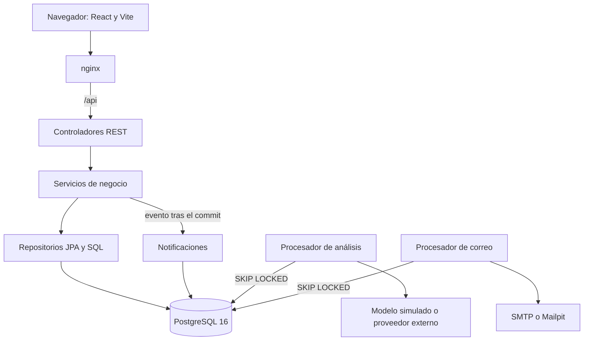

# Arquitectura

## Decisiones importantes

**Capas.** Los controladores solo traducen HTTP, los servicios tienen las reglas y los repositorios el
acceso a datos. Las reglas se prueban con PostgreSQL real.

**Alcance en el servicio.** El rol se valida en el método y el alcance por facultad en
`DocenteService.buscarDocenteVisible`. Un recurso fuera de alcance responde 404, igual que uno
inexistente, para no confirmar que existe.

**A4.** El docente nunca recibe notas por fuente ni un promedio parcial. La regla está en los DTO que
se le devuelven, no en la pantalla.

**Análisis asíncrono.** La solicitud se guarda en EN_COLA y responde 202. Un procesador la toma con
`FOR UPDATE SKIP LOCKED`, llama al modelo fuera de transacción y guarda el borrador. Al arrancar, lo
huérfano vuelve a la cola o queda en ERROR tras tres intentos.

**Outbox de notificaciones.** El negocio publica un evento y el aviso se crea después del commit. El
correo se escribe en una tabla y otro proceso lo envía. Un SMTP caído no afecta una firma. Ver
[NOTIFICACIONES.md](NOTIFICACIONES.md).

**Ventanas de etapa.** Cada etapa tiene fechas y las operaciones consultan `VentanaEtapaService` con un
`Clock`. No hay tareas que abran o cierren nada: la fecha decide, y una etapa cerrada responde 409.

**Actas inmutables.** Un trigger de la base rechaza cambios en un acta firmada. La corrección crea una
versión nueva y anula la anterior.

**Concurrencia.** `@Version` protege actas, hallazgos y citas. La reserva bloquea la franja y la
publicación bloquea la solicitud. Los índices únicos son la última defensa.

**Auditoría.** Se inserta en su propia transacción para conservar los intentos fallidos, y un trigger
rechaza cambios y borrados.

**Errores.** Todo error sale en RFC 7807 con `correlationId`. Ese mismo identificador va en los logs y
en la cabecera `X-Correlation-Id`.
