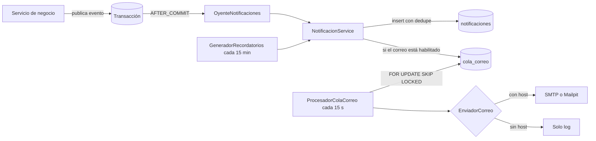

# Notificaciones

Cada rol se entera de lo que le toca sin filtrar datos y sin que un fallo de correo afecte el negocio.

Los títulos y mensajes son textos fijos del enum `TipoNotificacion`. Por eso ninguna nota, categoría,
comentario o hallazgo puede llegar a un aviso o a un correo. El único dato variable es el código de
verificación del acta y el nombre de la etapa.

## Flujo

- Si el negocio se revierte, no hay aviso.
- Cada destinatario va en su propia transacción. Un fallo se registra y no llega al negocio.
- La firma de un acta nunca habla con el servidor de correo: solo escribe en la cola.
- `UNIQUE (usuario_id, tipo, clave_dedupe)` hace idempotentes los eventos y los recordatorios.
- Reintentos: 5 en total, con espera de 2, 4, 8 y 16 minutos. Después queda en ERROR.

## Eventos

| Evento | Destinatario | Canal | Plantilla |
|--------|--------------|-------|-----------|
| Coordinación publica la revisión E4 | Docente | App y correo | `HALLAZGOS_PUBLICADOS` |
| Reserva de cita | Docente | App y correo | `CITA_AGENDADA` |
| Reserva que reemplaza otra cita | Docente | App y correo | `CITA_CAMBIADA` |
| 24 h antes de la cita | Docente | App y correo | `RECORDATORIO_CITA` |
| Acta lista: creada o con su compromiso | Docente | App y correo | `ACTA_POR_FIRMAR` |
| Acta con las dos firmas | Docente | App y correo, con código | `ACTA_FIRMADA` |
| Corrección de acta | Docente | App y correo | `ACTA_CORREGIDA` |
| Compromiso a 7 días y a 1 día | Docente | App y correo | `COMPROMISO_POR_VENCER` |
| Compromiso vencido | Docente | App y correo | `COMPROMISO_VENCIDO` |
| Análisis terminado | Quien lo pidió | App y correo | `ANALISIS_TERMINADO` |
| Análisis insuficiente | Quien lo pidió | App y correo | `ANALISIS_INSUFICIENTE` |
| Análisis con error | Quien lo pidió | App y correo | `ANALISIS_ERROR` |
| Reserva de cita | Coordinación de la facultad | App y correo | `CITA_RESERVADA` |
| Cita liberada al tomar otra | Coordinación de la facultad | App y correo | `CITA_REEMPLAZADA` |
| El docente firma | Coordinación de la facultad | App y correo | `ACTA_FIRMADA_DOCENTE` |
| Compromiso vencido | Coordinación de la facultad | App y correo | `COMPROMISO_VENCIDO_FACULTAD` |
| CSV terminado | Quien lo importó | App y correo | `IMPORTACION_EXITOSA`, `IMPORTACION_CON_ERRORES` |
| Etapa cierra en 3 días | Coordinaciones | App y correo | `VENTANA_POR_CERRAR` |
| Docente con resultado definitivo Muy bajo | Vicerrectoría | App y correo | `ALERTA_INFORMATIVA` |
| Etapa cerrada | Vicerrectoría | App y correo | `VENTANA_CERRADA` |
| Etapa abierta, hasta 3 días después de abrir | Coordinaciones; docentes si participan | App y correo | `VENTANA_ABIERTA` |

El seed de desarrollo no genera avisos ni correos. Los recordatorios reales, como un compromiso vencido, sí corren sobre esos datos.

## Configuración

| Variable | Uso |
|----------|-----|
| `DOCENTIA_MAIL_HOST`, `DOCENTIA_MAIL_PORT` | Servidor SMTP. Sin host, solo log. |
| `DOCENTIA_MAIL_USER`, `DOCENTIA_MAIL_PASS` | Credenciales |
| `DOCENTIA_MAIL_FROM`, `DOCENTIA_MAIL_TLS` | Remitente y STARTTLS |
| `DOCENTIA_APP_URL` | Base de los enlaces |
| `DOCENTIA_NOTIFICACIONES_RETENCION_DIAS` | Retención de avisos leídos, 90 por defecto |
