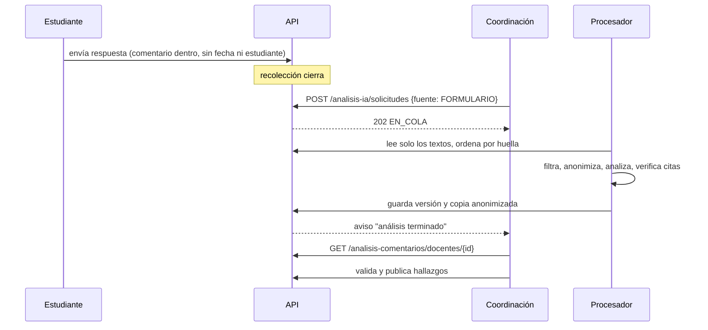

# Recorrido: análisis de comentarios del formulario

Recorrido por la API, sin pantallas: la interfaz la arma el frontend con
[api-comentarios-ia.md](../api-comentarios-ia.md). Los datos de ejemplo son sintéticos.

## Qué hace el flujo

| Quién | Qué hace |
|-------|----------|
| Estudiante | Responde el formulario con un comentario opcional. No pasa nada más en ese momento |
| Recolección | Cierra según el calendario del periodo |
| Coordinación | Pide el análisis con `fuente: FORMULARIO` y lo revisa |
| Modelo local | Filtra, anonimiza, etiqueta y cuenta; propone hallazgos con citas |
| Coordinación | Valida o descarta cada hallazgo y publica (E4) |
| Docente | Ve solo los hallazgos publicados, sin citas ni comentarios |



## Pasos con curl

```bash
TOKEN=...   # sesión de coordinación
curl -X POST localhost:8080/api/analisis-ia/solicitudes -H "Authorization: Bearer $TOKEN" \
  -H 'Content-Type: application/json' -d '{"docenteId":12,"periodoId":3,"fuente":"FORMULARIO"}'
curl "localhost:8080/api/analisis-comentarios/docentes/12?periodo=3" -H "Authorization: Bearer $TOKEN"
curl "localhost:8080/api/comentarios-estudiantes/docentes/12?periodo=3&sentimiento=NEGATIVO" \
  -H "Authorization: Bearer $TOKEN"
curl "localhost:8080/api/analisis-comentarios/resumen?periodo=3" -H "Authorization: Bearer $TOKEN"
```

Con la recolección abierta, el `POST` responde 409 y el `GET` devuelve `NO_DISPONIBLE_AUN` con
`motivo: VENTANA_ABIERTA`.

## Lo que se probó

Contra la API con MockMvc y PostgreSQL real (`AnalisisComentariosTest`). No hay pruebas de pantalla
de este módulo en este cambio.
