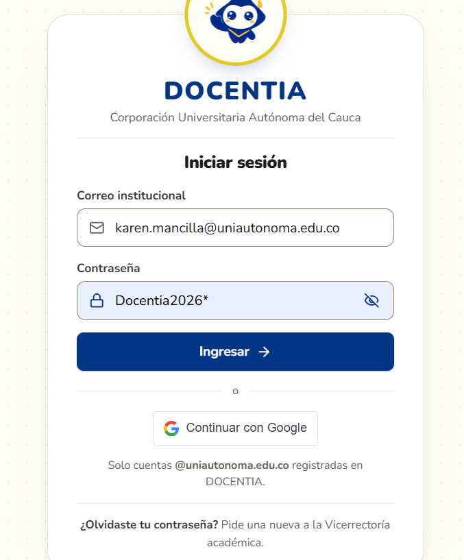
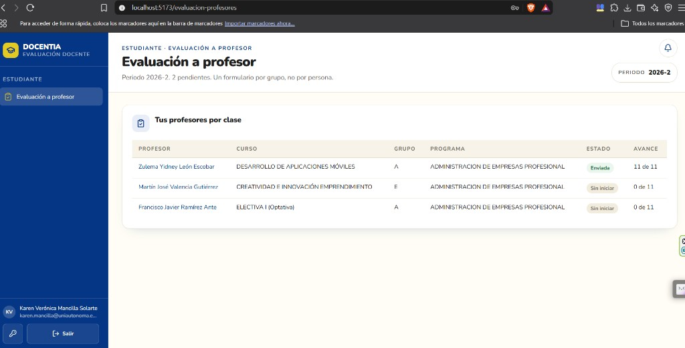
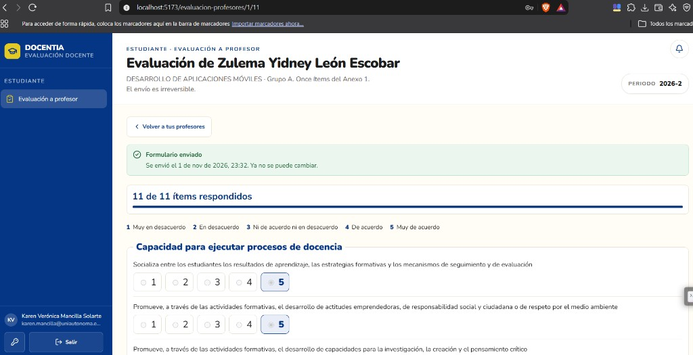
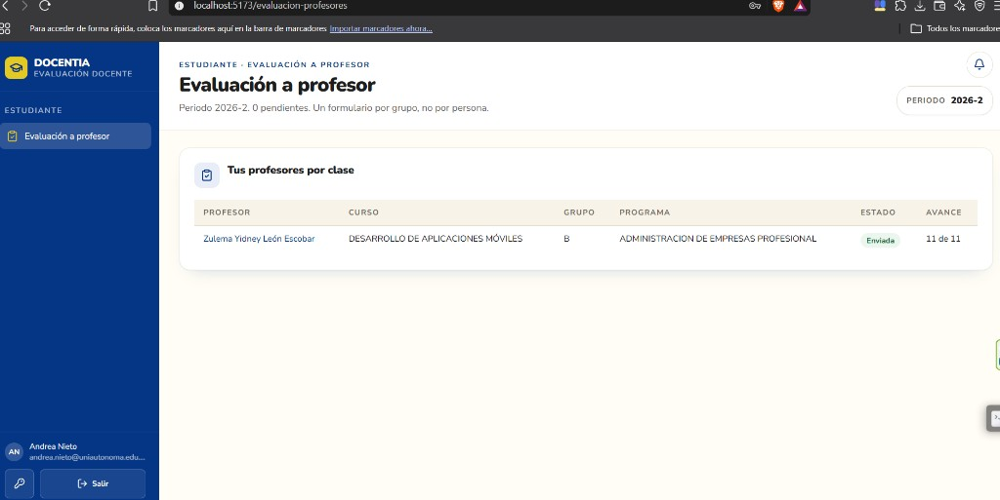
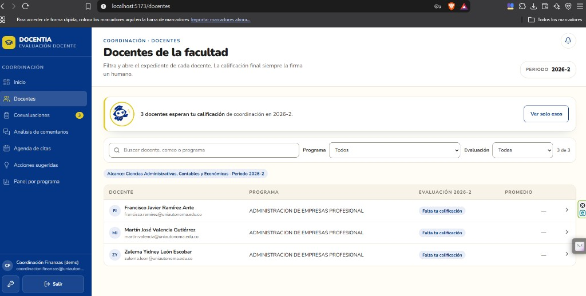
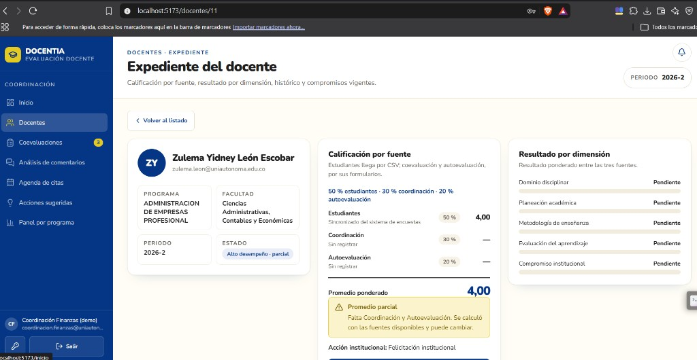
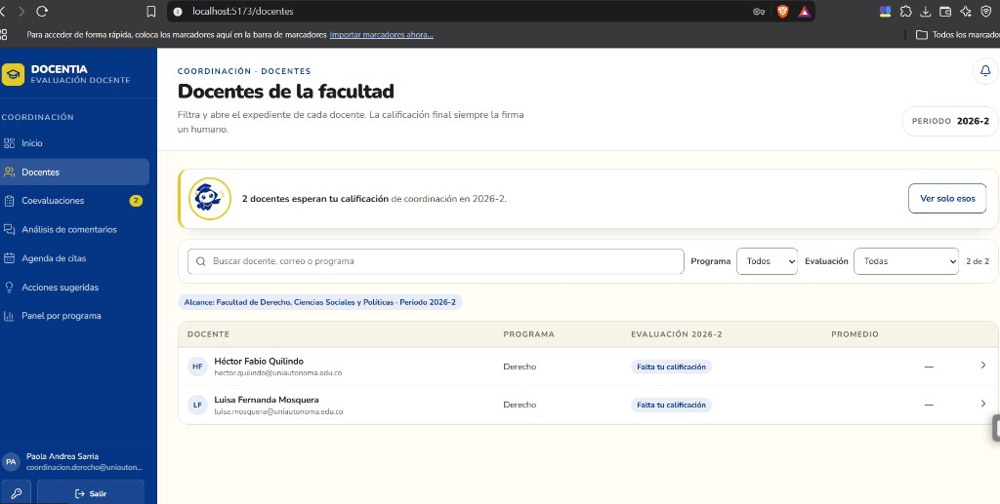
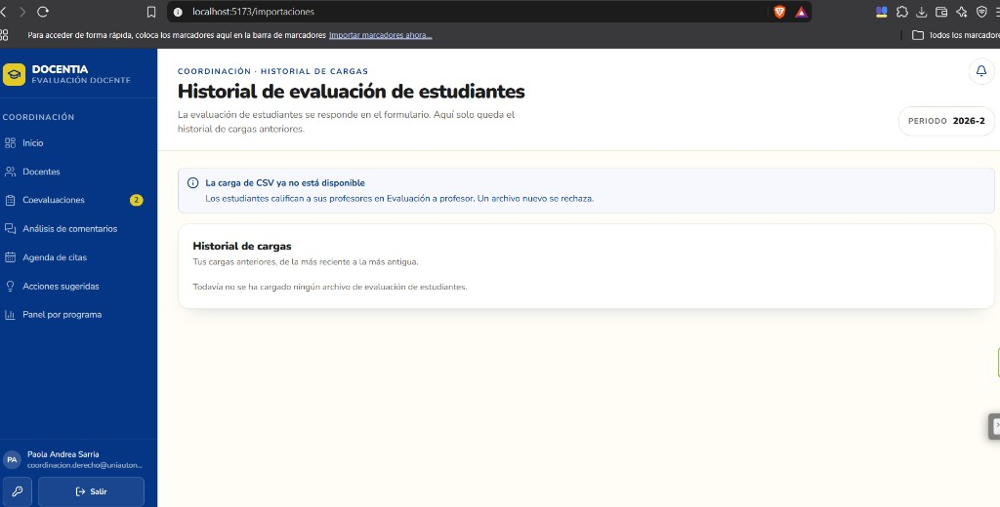

# Recorrido: el estudiante evalúa a su profesor

Así queda en DOCENTIA la fuente **Estudiantes (50 %)** de la Resolución 074.
Ya no se sube un Excel: cada estudiante entra a la app, ve **solo las clases en las que está matriculado** y responde el Anexo 1 (11 ítems HETERO). Al enviar, se calcula la media de esos formularios para el docente en el periodo.

Estas capturas son de la demo local (`http://localhost:5173`), periodo **2026-2**. Contraseña de todas las cuentas: **`Docentia2026*`**.

Para enviarlo por WhatsApp: compacta **esta carpeta completa** (`recorrido-heteroevaluacion/`, con `FLUJO.md` e `imagenes/`). Si se manda solo el `.md`, las fotos no se ven.

---

## Qué hace el flujo

| Quién | Qué ve / qué hace |
|-------|-------------------|
| Estudiante | Un solo menú: **Evaluación a profesor**. Un formulario por clase (curso + grupo + profesor). |
| Coordinación de la facultad | En el expediente, la nota **Estudiantes**. Nunca quién puntó ni el detalle por estudiante. |
| Otra facultad | No ve a esos docentes. |
| Coordinación / Vicerrectoría | El menú ya no ofrece subir CSV. |

Caso de esta demo (el que pide el contrato):

- Karen envía **5** a Zulema en el **grupo A**.
- Andrea envía **3** a Zulema en el **grupo B**.
- Nota de Zulema en Estudiantes = **(5 + 3) / 2 = 4,00**.

---

## 1. Entrar como estudiante

Correo: `karen.mancilla@uniautonoma.edu.co`

El login no tiene atajos de cuentas: hay que escribir el correo.

---

## 2. Karen ve tres clases (las suyas)

Tras el login cae en **Evaluación a profesor**. El menú de estudiante **solo** tiene ese enlace.

Debe ver **tres profesores**, cada uno con su grupo:

| Profesor | Curso | Grupo |
|----------|--------|-------|
| Zulema Yidney León Escobar | Desarrollo de aplicaciones móviles | **A** |
| Martín José Valencia Gutiérrez | Creatividad e innovación emprendimiento | **E** |
| Francisco Javier Ramírez Ante | Electiva I | **A** |

Un formulario **por grupo**, no por persona: si el mismo profesor dicta A y B, Karen solo ve el suyo.

En la captura Zulema A ya está **Enviada (11 de 11)**; Martín y Francisco siguen **Sin iniciar**.

---

## 3. Karen responde el Anexo 1 (11 ítems) y envía

Abre a Zulema. El instrumento son **once descriptores** (D02–D12), escala 1 a 5, comentario opcional por criterio.

En esta corrida Karen marcó **5** en todos, confirmó que el envío es irreversible y envió. El formulario queda de solo lectura.

---

## 4. Andrea solo ve el grupo B

Correo: `andrea.nieto@uniautonoma.edu.co`

Misma asignatura que Karen, **otro grupo**. Andrea no ve el grupo A ni a Martín ni a Francisco.

---

## 5. Andrea envía 3 en el grupo B

Mismos 11 ítems. Aquí Andrea marcó **3** y envió. También queda irreversible.

Con eso el docente tiene **dos** heteroevaluaciones enviadas (A = 5 y B = 3). La fuente Estudiantes es la **media de esos formularios**, no un CSV.

---

## 6. Coordinación de Finanzas ve a los tres docentes

Correo: `coordinacion.finanzas@uniautonoma.edu.co`

Alcance: facultad **Ciencias Administrativas, Contables y Económicas**. En **Docentes** aparecen Zulema, Martín y Francisco. El menú **no** tiene “Evaluación de estudiantes” ni carga de Excel.

“Falta tu calificación” es la nota de **coordinación** (el 30 %). La de estudiantes ya puede estar registrada aunque esto siga pendiente.

---

## 7. Expediente de Zulema: Estudiantes = 4,00

En **Docentes → Zulema**:

- Estudiantes **4,00** (50 %) = media de Karen 5 y Andrea 3.
- Coordinación y autoevaluación sin registrar → promedio **parcial** 4,00.
- No aparecen nombres de estudiantes ni puntajes individuales.

El pie “Sincronizado del sistema de encuestas” es texto viejo de cuando la fuente llegaba por CSV; el valor **sí** sale de los formularios de esta app.

---

## 8. Otra facultad no ve a Zulema

Correo: `coordinacion.derecho@uniautonoma.edu.co`

Solo docentes de Derecho. Zulema, Martín y Francisco **no** aparecen: el alcance viaja en la sesión.

---

## 9. Ya no se sube el CSV de notas

La ruta `/importaciones` (si alguien la tiene guardada) muestra el aviso y el historial. **No hay selector de archivo.** Un `POST` nuevo al CSV responde 409: *La evaluación de estudiantes se responde en el formulario*.

---

## Cuentas para repetirlo

| Correo | Rol | Para qué |
|--------|-----|----------|
| `karen.mancilla@uniautonoma.edu.co` | Estudiante | Tres clases (Martín E, Zulema A, Francisco A) |
| `andrea.nieto@uniautonoma.edu.co` | Estudiante | Solo Zulema grupo B |
| `coordinacion.finanzas@uniautonoma.edu.co` | Coordinador | Expediente y nota 4,00 de Zulema |
| `coordinacion.derecho@uniautonoma.edu.co` | Coordinador | Comprobar que no ve esa facultad |

Contraseña: `Docentia2026*`. Un formulario **enviado no se puede volver a editar**.
